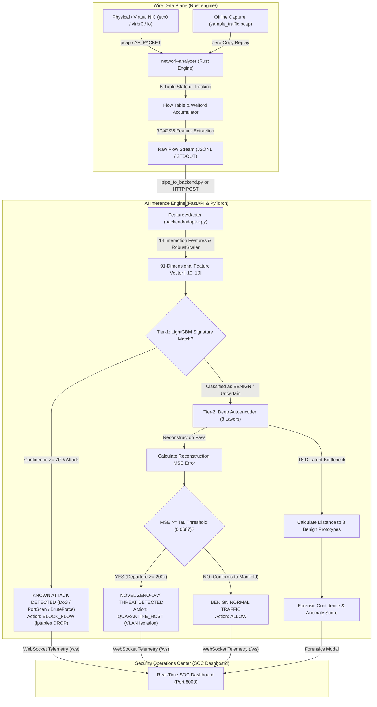

# Kadak: Autonomous Network Intrusion Detection System (v1.1)
### Wire-Speed Rust Telemetry Engine & Dual-Tier Hybrid AI Defense Architecture

[](#)
[](#)
[](#)
[](#)
[](#)
[](#)

---

## Executive Summary & Problem Statement

In enterprise telecommunications and cloud infrastructure, traditional signature-based firewalls (such as AWS WAF, Suricata, or Snort) suffer from a fundamental architectural flaw: **they can only detect attacks they have seen before**. When an advanced persistent adversary launches a **Zero-Day exploit (unseen payload or novel subspace deviation)**, signature matching fails completely, allowing lateral network infiltration.

**Kadak v1.1** combines a high-performance **Rust Wire Data Plane** with a **Dual-Tier Hybrid AI Defense System**:
1. **Tier-1 (Supervised - LightGBM GBDT):** Identifies known cyberattack signatures (`DoS`, `PortScan`, `BruteForce`) with sub-millisecond classification latency.
2. **Tier-2 (Unsupervised - Deep Autoencoder):** Trained strictly on the manifold of normal (`BENIGN`) telecommunication traffic. When novel Zero-Day threats arrive, the neural network fails to compress/reconstruct them, triggering instant manifold departure ($\text{MSE} \ge \tau = 0.0687$) and automated host quarantine (`QUARANTINE_HOST`).
3. **Latent Prototypes (KMeans Centroids):** 8 geometric centroids in 16-D bottleneck space compute real-time novelty distances for forensic confidence scoring.
4. **Wire-Speed Data Plane (`engine/`):** A standalone, memory-safe Rust network analysis engine performing live packet capture and offline PCAP replay, stateful bidirectional flow tracking, and streaming feature extraction compatible with **CICIDS2017**, **UNSW-NB15**, and **NSL-KDD**.

---

## Clean Modular Architecture (v1.1)

```
kadak/
├── engine/                     # High-Performance Rust Wire Data Plane
│   ├── Cargo.toml              # Rust crate dependencies & release profile
│   ├── src/
│   │   ├── main.rs             # CLI driver, live capture, and PCAP replay
│   │   ├── lib.rs              # Public library exports
│   │   ├── capture.rs          # libpcap live capture & offline PCAP reader
│   │   ├── packet.rs           # Zero-copy protocol parser (Eth, IP, TCP, UDP, ICMP)
│   │   ├── flow.rs             # Bidirectional flow tracker & TCP state machine
│   │   ├── flow_table.rs       # Concurrent flow table & LRU expiration reaper
│   │   ├── statistics.rs       # Welford online accumulator for mean & variance
│   │   ├── features.rs         # 71 CICIDS2017, 42 UNSW-NB15, 28 NSL-KDD extractors
│   │   ├── output.rs           # Buffered JSONL & CSV streaming serializers
│   │   └── config.rs           # Engine configuration & timeouts
│   └── tests/                  # Integration test suite (19 unit & flow tests)
│       ├── test_flow.rs
│       ├── test_flow_table.rs
│       └── test_packet.rs
├── backend/                    # FastAPI AI Control Plane & Telemetry Broadcaster
│   ├── main.py                 # ASGI application, WebSockets (/ws, /ws/telemetry), replay manager
│   ├── risk_engine.py          # PyTorch Deep Autoencoder + LightGBM + Prototype centroids
│   ├── adapter.py              # 77 Raw -> 91 feature transformation & RobustScaler
│   └── test_backend.py         # Automated verification diagnostic suite
├── frontend/                   # Real-Time SOC Presentation Plane (Modular Web App)
│   ├── index.html              # Modern dark-mode analyst dashboard
│   ├── styles.css              # Cyberpunk / Terminal glassmorphism styling
│   └── app.js                  # WebSocket client, Chart.js ECG engine, forensics modal
├── models/                     # Production Model Weights & Schema Artifacts
│   ├── autoencoder.pt          # PyTorch 8-layer deep reconstruction network
│   ├── lightgbm_model.pkl      # Supervised GBDT classifier for known signatures
│   ├── scaler.pkl              # RobustScaler parameters
│   ├── metadata.json           # Model hyperparameters, tau threshold (0.0687), centroids
│   ├── feature_list.json       # Canonical 91-feature schema
│   └── evaluation_dashboard.png # Multi-panel evaluation dashboard
├── notebooks/                  # AI Research & Pipeline Reproducibility
│   ├── 01_nids_model_training.ipynb # Interactive training & validation notebook
│   └── train_pipeline.py       # Standalone end-to-end model training script
├── data/                       # All 3 Benchmark Standards in Separate Folders
│   ├── cicids2017/             # CICIDS2017 Benchmark (77 Raw Features)
│   │   ├── cicids2017_benchmark.csv
│   │   └── schema.json
│   ├── unsw_nb15/              # UNSW-NB15 Benchmark (42 Flow Metrics)
│   │   ├── unsw_nb15_benchmark.csv
│   │   └── schema.json
│   ├── nsl_kdd/                # NSL-KDD Benchmark (41 Connection Features)
│   │   ├── nsl_kdd_benchmark.csv
│   │   └── schema.json
│   └── generate_datasets.py    # Universal dataset generator for all 3 standards
├── scripts/                    # Automation & Emulation Tooling
│   ├── run_traffic_agent.py    # Live traffic & attack emulation stream runner
│   ├── pipe_to_backend.py      # Rust engine stdout -> FastAPI streaming pipe
│   ├── generate_demo_traffic.py# Demo traffic JSONL generator
│   ├── diagnostic_comparison.py# Diagnostic comparison across model tiers
│   ├── simulate_vm_traffic.py  # VM network load simulator
│   └── test_live_packet_to_alert.py # End-to-end live packet to alert test
├── docs/                       # Specifications & Demo Documentation
│   ├── DEMO_GUIDE.md           # Step-by-step SOC demonstration walkthrough
│   └── feature-mapping.md      # Full 71/42/28 feature mappings for all 3 datasets
├── figures/                    # Publication-Quality Research Visualizations
│   ├── confusion_matrix_heatmap.png
│   ├── drift_adaptation_plot.png
│   ├── fpr_vs_recall_tradeoff.png
│   ├── pr_curves.png
│   ├── roc_curves.png
│   ├── shap_feature_importance.png
│   └── unseen_attack_recall_by_family.png
├── sample_traffic.pcap         # Sample offline PCAP capture
├── report.pdf                  # Comprehensive research paper & technical report
├── requirements.txt            # Python production dependencies
└── .gitignore                  # Git exclusion rules
```

---

## End-to-End System Pipeline



---

## Benchmark Datasets Supported (`data/`)

Kadak natively extracts features and provides calibrated benchmark datasets for all three major network intrusion detection standards:

| Dataset Standard | Directory Location | Features Implemented | Unavailable (Ground Truth / Host OS) | Target Classes |
| :--- | :--- | :---: | :---: | :--- |
| **CICIDS2017** | `data/cicids2017/` | **71 / 71 (100%)** | 0 | BENIGN, DoS, PortScan, BruteForce, Infiltration_ZeroDay |
| **UNSW-NB15** | `data/unsw_nb15/` | **42 / 44 (95.5%)** | 2 (`attack_cat`, `label`) | Normal, Generic, Exploits, Fuzzers, DoS |
| **NSL-KDD** | `data/nsl_kdd/` | **28 / 41 (68.3%)** | 13 (OS/host audit) | normal, neptune, satan, smurf, warezclient |

To generate or regenerate all three datasets simultaneously:
```bash
python data/generate_datasets.py
```

---

## Quickstart & Installation

### 1. Set Up Python Environment

```bash
# Clone the repository and switch to branch v1.1
git checkout v1.1

# Create and activate virtual environment
python3 -m venv .venv
source .venv/bin/activate

# Install dependencies
pip install -r requirements.txt
```

### 2. Verify AI Models & Inference Diagnostic Suite

Run the automated backend test suite:
```bash
python backend/test_backend.py
```

Expected diagnostic output:
```
=================================================================
 Running NIDS Backend Diagnostic Suite...
=================================================================
 RiskEngine initialized successfully on: cpu / cuda / mps
   Input feature dimensions : 91
   Calibrated threshold (tau): 0.0687
   Cluster prototypes loaded : 8
-----------------------------------------------------------------
 Testing [BENIGN]   : MSE: 0.0016 (tau=0.0687) -> ALLOW
 Testing [DoS]      : LightGBM Signature Match -> BLOCK_FLOW
 Testing [PortScan] : LightGBM Signature Match -> BLOCK_FLOW
 Testing [ZeroDay]  : MSE: 16.0822 (tau=0.0687) -> QUARANTINE_HOST
=================================================================
 All 4 traffic categories successfully validated against Dual-Tier AI!
```

### 3. Build & Test Rust Wire Engine

```bash
cd engine

# Run the 19 integration tests
cargo test

# Build optimized release binary
cargo build --release
cd ..
```

### 4. Launch the Production Backend & SOC Dashboard

Start the FastAPI ASGI server:
```bash
uvicorn backend.main:app --host 127.0.0.1 --port 8000 --reload
```

Open your browser to:
**`http://127.0.0.1:8000/`**
*(Explore interactive OpenAPI / Swagger documentation at `http://127.0.0.1:8000/docs`)*

### 5. Stream Live Traffic & Attack Emulation

In a second terminal window, run the traffic agent:
```bash
python scripts/run_traffic_agent.py
```

Or run the live packet sniffer against an active network interface:
```bash
sudo ./engine/target/release/network-analyzer -i eth0 --flow-timeout 1 -f jsonl | python3 scripts/pipe_to_backend.py
```

Or replay an offline PCAP file:
```bash
./engine/target/release/network-analyzer --pcap sample_traffic.pcap -f jsonl | python3 scripts/pipe_to_backend.py
```

---

## Autonomous Operational Actions

| Threat Category | Detection Tier | Action Taken | Operational Mechanism |
| :--- | :--- | :---: | :--- |
| **BENIGN** | Dual-Tier Clear | `ALLOW` | Passes through without latency penalty |
| **DoS (Flood)** | Tier-1 LightGBM | `BLOCK_FLOW` | Hardware/Kernel-level drop (`iptables -A INPUT -s IP -j DROP`) |
| **PortScan** | Tier-1 LightGBM | `BLOCK_FLOW` | Perimeter port probe dropped; IP added to temporary blocklist |
| **Zero-Day (Novel)** | Tier-2 Autoencoder | `QUARANTINE_HOST` | Host isolated to quarantine VLAN; active JWTs revoked; memory dumped for forensics |

---

## License

This project is distributed under the Apache License 2.0. See [LICENSE](LICENSE) for details.
